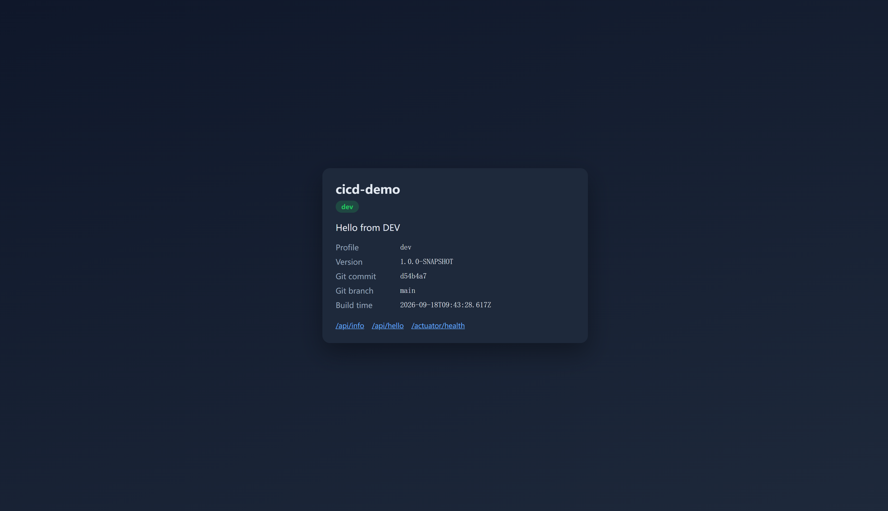
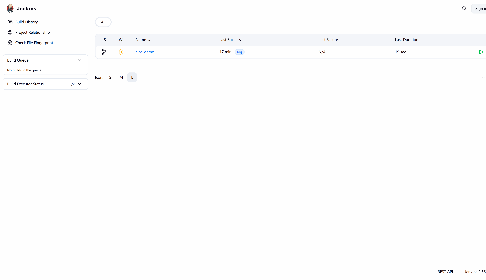
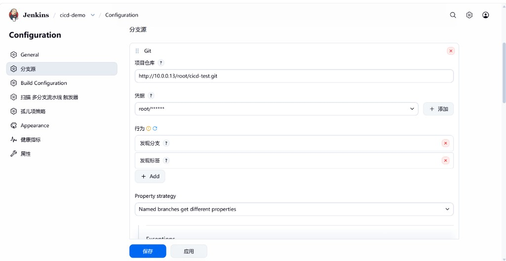

# 阶段0部署操作手册（GitLab仓 + Jenkins）

> **目标**：`main` 推送 → Jenkins 构建测试 → scp jar → app-dev **systemd** → 浏览器 `http://<app-dev>:8090/` 显示 **dev**。  
> **不做**：Docker、test/prod、镜像仓库（阶段 1）。  
> **配套方案**：[jenkins-gitlab-small-company.md](./jenkins-gitlab-small-company.md) · 完整实施：[implement-jenkins.md](./implement-jenkins.md)  
> **账号密码全文**：[环境凭据一览.md](./环境凭据一览.md)（含 GitLab / Jenkins / PAT / SSH）

---

## 0. 环境实绩（本仓库已落地）

| 角色 | IP | 用户 | 说明 |
|------|-----|------|------|
| platform | 10.0.0.13 | platform | GitLab + Jenkins |
| app-dev | 10.0.0.12 | platform | systemd 跑 jar，端口 **8090** |
| app-prod | 10.0.0.11 | — | 阶段0 **不用** |

| 服务 | 地址 |
|------|------|
| GitLab | http://10.0.0.13 |
| Jenkins | http://10.0.0.13:**8081**（8080 被 GitLab 占用） |
| 应用 dev | http://10.0.0.12:8090/ |

### 0.1 登录账号（摘要）

| 系统 | 地址 | 用户名 | 密码 |
|------|------|--------|------|
| GitLab | http://10.0.0.13 | `root` | `7ChvoInxILTnI5skTMTR` |
| Jenkins | http://10.0.0.13:8081 | `root` | `yq4QnbJKVTUjwv4juBJZ` |
| GitLab PAT（Jenkins 拉代码 / Registry） | — | `root` | `3421b99f1706de819496017f65bb38e2c64e484a` |
| SSH 部署 | `deploy@10.0.0.12` | `deploy` | 私钥 `.secrets/cicd-deploy`（无登录密码） |

完整说明见 [环境凭据一览.md](./环境凭据一览.md)。

验收页示例：



---

## 1. 架构（阶段0）

```text
开发机 git push
    → GitLab(10.0.0.13) 仓 root/cicd-test
    → Webhook
    → Jenkins(10.0.0.13:8081) Job cicd-demo / main
        → mvn verify
        → scp jar → deploy@10.0.0.12
        → systemctl restart cicd-demo
    → 浏览器 http://10.0.0.12:8090/
```

---

## 2. 操作总览（按顺序勾）

| # | 步骤 | 约时 |
|---|------|------|
| 1 | 机器互通、扩容磁盘、装 JDK | 30～60 分 |
| 2 | platform 装 GitLab，建项目，关 Auto DevOps | 40～90 分 |
| 3 | platform 装 Jenkins（端口 8081）、插件、工具 | 20～40 分 |
| 4 | 部署密钥 + app-dev 用户/目录/systemd | 20～30 分 |
| 5 | Jenkins 凭据、全局变量、Multibranch Job | 15～25 分 |
| 6 | GitLab Webhook（含允许内网） | 10～20 分 |
| 7 | 本机 push → 构建绿 → 打开 8090 | 10～20 分 |

---

## 3. 机器与前置

### 3.1 各机

```bash
sudo apt update && sudo apt install -y curl git openjdk-21-jdk
java -version
```

若根分区只有约 19G、VG 还有空闲空间（常见云盘默认）：

```bash
sudo lvextend -l +100%FREE /dev/ubuntu-vg/ubuntu-lv
sudo resize2fs /dev/ubuntu-vg/ubuntu-lv
df -h /
```

### 3.2 防火墙端口

| 端口 | 机器 | 用途 |
|------|------|------|
| 22 | 全部 | SSH |
| 80 | platform | GitLab |
| 8081 | platform | Jenkins |
| 8090 | app-dev | 应用 |

---

## 4. 安装 GitLab（仅代码仓）

在 **platform**：

```bash
curl -fsSL https://packages.gitlab.com/install/repositories/gitlab/gitlab-ce/script.deb.sh | sudo bash
sudo EXTERNAL_URL="http://10.0.0.13" apt-get install -y gitlab-ce
sudo gitlab-ctl reconfigure
```

1. 浏览器打开 http://10.0.0.13 ，用初始 root 密码登录（`/etc/gitlab/initial_root_password`，24 小时内有效），**立刻改密**。
2. 新建项目 **`cicd-test`**（或已存在则跳过）。
3. 项目 **Settings → CI/CD → Auto DevOps**：**取消**「Default to Auto DevOps pipeline」→ Save。

> 注意：要进**项目**的 Settings，不要只在 Admin area 里找。

内存约 8G 时建议在 `/etc/gitlab/gitlab.rb` 限制 Puma/Sidekiq，再 `sudo gitlab-ctl reconfigure`。

登录后界面示例：


---

## 5. 安装 Jenkins

### 5.1 安装（注意 2026 新密钥）

```bash
curl -fsSL https://pkg.jenkins.io/debian-stable/jenkins.io-2026.key \
  | sudo tee /usr/share/keyrings/jenkins-keyring.asc > /dev/null
echo 'deb [signed-by=/usr/share/keyrings/jenkins-keyring.asc] https://pkg.jenkins.io/debian-stable binary/' \
  | sudo tee /etc/apt/sources.list.d/jenkins.list
sudo apt-get update && sudo apt-get install -y fontconfig jenkins
```

GitLab 已占用 **8080**，Jenkins 改 **8081**：

```bash
# /etc/default/jenkins → HTTP_PORT=8081
# 并在 systemd drop-in 设 Environment="JENKINS_PORT=8081"
sudo systemctl daemon-reload
sudo systemctl restart jenkins
sudo cat /var/lib/jenkins/secrets/initialAdminPassword
```

浏览器：http://10.0.0.13:8081 → 解锁 → 装插件（**Git、Pipeline、GitLab、SSH Agent、Credentials Binding**）→ 创建管理员。

首页示例（Job 绿表示阶段0已通）：



### 5.2 全局变量

**Manage Jenkins → System（系统配置）→ Global properties → Environment variables**

| Name | Value |
|------|--------|
| `APP_DEV_HOST` | `10.0.0.12` |

> 不要进「系统信息」页，那是只读查看。


### 5.3 凭据（ID 必须一致）

**Manage Jenkins → Credentials → (global) → Add**

| ID | 类型 | Username / Secret | 用途 |
|----|------|-------------------|------|
| `gitlab-credentials` | Username + Password | `root` + PAT（见 [凭据一览](./环境凭据一览.md)） | 拉 GitLab 代码（用 PAT，不要用网页登录密码） |
| `deploy-ssh` | SSH Username with private key | `deploy` + `.secrets/cicd-deploy` | SSH 部署 |

部署密钥生成示例：

```bash
ssh-keygen -t ed25519 -f cicd-deploy -N "" -C "cicd-deploy"
```

---

## 6. 准备 app-dev（systemd）

```bash
sudo useradd -m -s /bin/bash deploy || true
sudo useradd -r -s /usr/sbin/nologin cicd || true
sudo mkdir -p /home/deploy/.ssh /opt/cicd-demo /etc/cicd-demo
# 写入公钥到 authorized_keys，chmod 600/700，chown deploy
sudo chown deploy:deploy /opt/cicd-demo

# sudoers（路径用 /usr/bin/systemctl）
echo 'deploy ALL=(root) NOPASSWD: /usr/bin/systemctl restart cicd-demo, /usr/bin/systemctl status cicd-demo, /usr/bin/systemctl is-active cicd-demo' \
  | sudo tee /etc/sudoers.d/cicd-deploy
sudo chmod 440 /etc/sudoers.d/cicd-deploy

sudo cp deploy/systemd/dev.env.example /etc/cicd-demo/dev.env
sudo chmod 600 /etc/cicd-demo/dev.env
sudo cp deploy/systemd/cicd-demo.service /etc/systemd/system/
# 演示可把 User=/Group= 改为 deploy
sudo systemctl daemon-reload && sudo systemctl enable cicd-demo
```

---

## 7. Multibranch Job

1. **New Item** → `cicd-demo` → **Multibranch Pipeline**
2. **分支源（Branch Sources）→ + 增加源 → Git**
   - **项目仓库**：`http://10.0.0.13/root/cicd-test.git`
   - **凭据**：`gitlab-credentials`（`root` + PAT）
   - **行为（Behaviors）** — 点 **+ Add**，至少加这两项：
     | 行为 | 界面名 | 作用 |
     |------|--------|------|
     | Discover branches | **发现分支** | 扫描 `main` 等分支，日常 push 走这里 |
     | Discover tags | **发现标签** | 扫描 `v*` 等 tag；阶段1 打 tag 部署 prod **必须有** |
   - 默认往往只有「发现分支」；**创建 Job 时就把「发现标签」一起加上**，避免阶段1 再改配置、漏扫 tag。
3. **构建设置**：脚本路径 `Jenkinsfile`（默认）
4. **保存** → **立即扫描多分支流水线（Scan Multibranch Pipeline Now）**

配置示意（分支源里已同时勾选发现分支 + 发现标签）：



扫描后：
- **Branches** 页会出现 `main`
- **Tags** 页会出现已有 `v*`（没有 tag 时该页为空，属正常）

分支页示例：


`main` 成功示例：


构建详情（含 GitLab 仓地址）示例：


---

## 8. GitLab Webhook

### 8.1 先允许内网出站

**Admin area → Settings → Network → Outbound requests**

1. **不要**勾选 `Block all requests, except for allowlist`（会把其它项弄灰并保存失败）
2. **勾选** `Allow requests to the local network from webhooks and integrations`
3. 可选白名单填：`10.0.0.13`
4. **Save changes**

也可写 `/etc/gitlab/gitlab.rb`：

```ruby
gitlab_rails['allow_local_requests_from_web_hooks_and_services'] = true
```

然后 `sudo gitlab-ctl reconfigure`。

### 8.2 添加 Webhook（项目内，不是 Admin）

打开：http://10.0.0.13/root/cicd-test/-/hooks

| 项 | 值 |
|----|-----|
| URL | `http://root:<API_TOKEN>@10.0.0.13:8081/project/cicd-demo` |
| Trigger | **Push events** |

保存后 **Test → Push events**，期望 **HTTP 200**。

---

## 9. 本机推送代码

仓库根目录需有阶段0 `Jenkinsfile`（Checkout → Build & Test → Deploy Dev）。

```bash
cd /path/to/cicd-test
git init   # 若尚无
git add app deploy docs Jenkinsfile README.md .gitignore
# 不要提交 .secrets/
git commit -m "phase0: jenkins systemd"
git remote add gitlab http://10.0.0.13/root/cicd-test.git
git branch -M main
git push -u gitlab main
```

Windows Git Credential Manager 可能提示：

```text
fatal: Unencrypted HTTP is not recommended...
```

内网可忽略；只要后面出现 `main -> main` 即 push 成功。

---

## 10. 验收

- [x] Jenkins `cicd-demo` / `main` 构建绿色  
- [x] `http://10.0.0.12:8090/` 显示 **dev** / Hello from DEV  
- [x] `/api/info`、`/actuator/health` 正常  

---

## 11. 踩坑记录（本环境真实遇到）

### 11.1 Jenkins 装不上：`NO_PUBKEY 7198F4B714ABFC68`

**原因**：旧文档用的 `jenkins.io-2023.key`，当前仓库需 **2026** 密钥。  
**处理**：改用 `https://pkg.jenkins.io/debian-stable/jenkins.io-2026.key`。

### 11.2 Jenkins 起不来 / 8080 被占

**原因**：GitLab 占用 8080（本机回环也有监听）。  
**处理**：Jenkins 改 **8081**；Webhook URL 同步改端口。

### 11.3 磁盘不够装 GitLab

**现象**：根分区约 19G，空闲 <10G。  
**处理**：`lvextend` + `resize2fs` 把 VG 空闲扩上（本环境扩到约 38G）。

### 11.4 Webhook：`Invalid url given`

**原因**：GitLab 默认禁止 Webhook 访问内网 IP（`10.x`）。  
**处理**：见 §8.1 允许本地网络请求。

### 11.5 保存 Network 失败：`Application settings update failed`

**原因**：误勾了 **Block all requests, except for allowlist**，未填完整白名单。  
**处理**：取消 Block all；只勾「允许 Webhook 访问本地网络」。

### 11.6 Webhook 测试：`HTTP 403 anonymous is missing the Job/Build permission`

**原因**：授权策略收紧后，匿名无 Build 权限（**推荐**：网页必须登录）。  
**处理（推荐，2026-10-15 已落地）**：
1. 安全矩阵：`anonymous` **不赋权**；`root` = Administer；`authenticated` = Job Read/Build 等  
2. Jenkins 为 `root` 建 **API Token**（名如 `gitlab-webhook`）  
3. GitLab Webhook URL 写成：`http://root:<API_TOKEN>@10.0.0.13:8081/project/cicd-demo`  

**不推荐**：给 `anonymous` Job/Build（可未登录浏览/触发构建）。临时演示才可。  
口令与 Token 见 [环境凭据一览.md](./环境凭据一览.md)。

### 11.7 保存安全配置：`No valid crumb was included`

**原因**：页面会话/CSRF crumb 失效（长时间停留或异常操作）。  
**处理**：重新打开 Security 页再保存；必要时重新登录。

### 11.8 密码概念混淆

| 东西 | 是什么 | 不是什么 |
|------|--------|----------|
| `initialAdminPassword` | Jenkins **首次解锁** | 日常登录密码 |
| GitLab `initial_root_password` | GitLab root 初始密码 | Jenkins 密码 |
| GitLab PAT | Jenkins 拉代码凭据密码 | Jenkins/GitLab 登录密码 |

### 11.9 `deploy` sudo 要密码

**原因**：sudoers 写了 `/bin/systemctl`，实际路径是 `/usr/bin/systemctl`。  
**处理**：sudoers 使用 `/usr/bin/systemctl`，`visudo -cf` 校验。

### 11.10 push 提示 Unencrypted HTTP

**现象**：GCM 警告，但对象仍写入成功。  
**处理**：内网演示可忽略；或配置 allow unsafe remotes / 改用 HTTPS。

---

## 12. 日常运维（阶段0）

| 动作 | 怎么做 |
|------|--------|
| 发版 | `git push gitlab main` |
| 看构建 | Jenkins → cicd-demo → main |
| 看日志 | app-dev：`sudo journalctl -u cicd-demo -f` |
| 手动重启 | `ssh deploy@10.0.0.12 'sudo systemctl restart cicd-demo'` |
| 回滚 jar | 用上一次成功构建的 jar scp 上去再 restart |

---

## 13. 与阶段1的边界

阶段0结束即可停。阶段1再加：Docker、Registry、8091/8092、prod `input` 审批。  
两套 CI（GitLab CI 与 Jenkins）**不要**同时自动打同一环境。

---

## 14. 图片目录

```text
docs/images/phase0/
  01-app-dev-8090.png
  02-jenkins-dashboard.png
  03-jenkins-multibranch.png
  04-jenkins-main-green.png
  05-jenkins-build1.png
  06-gitlab-after-login.png
  07-jenkins-discover-branches-tags.png   # 分支源：发现分支 + 发现标签
```
