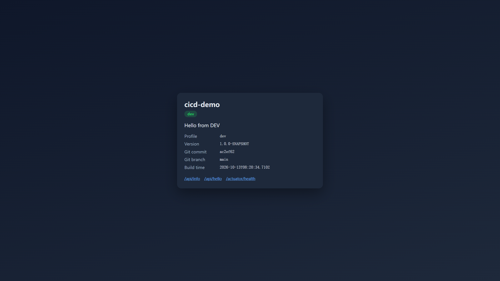
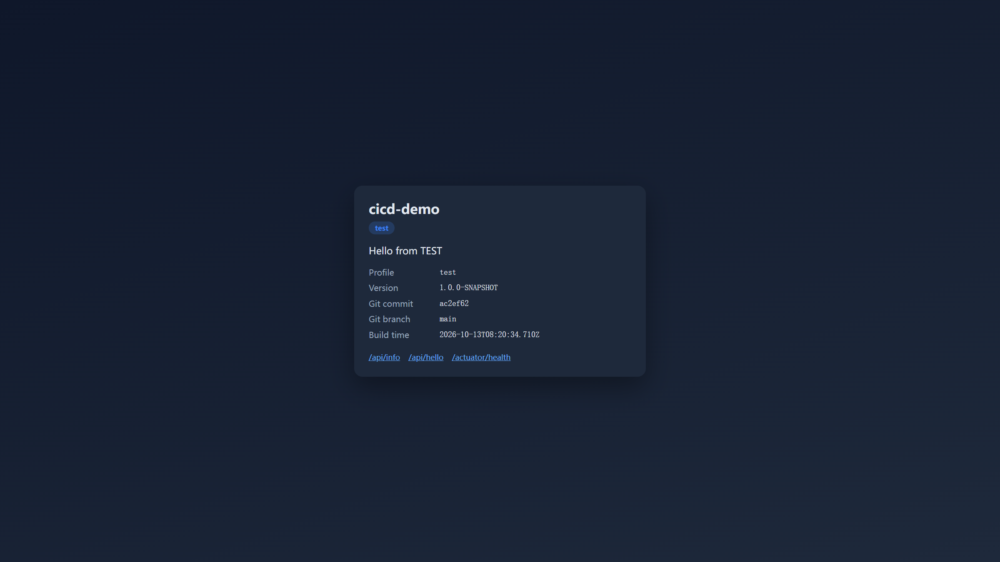
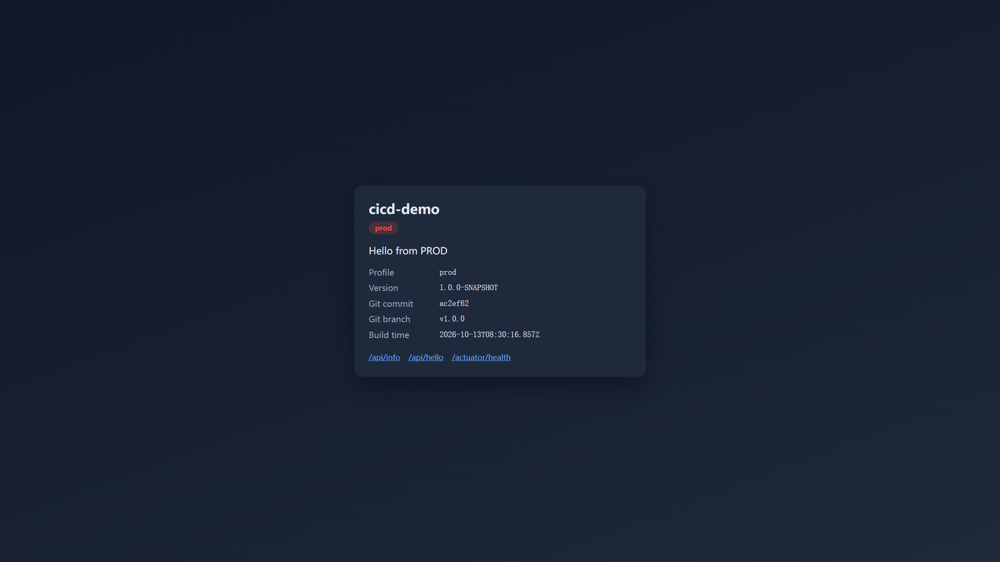
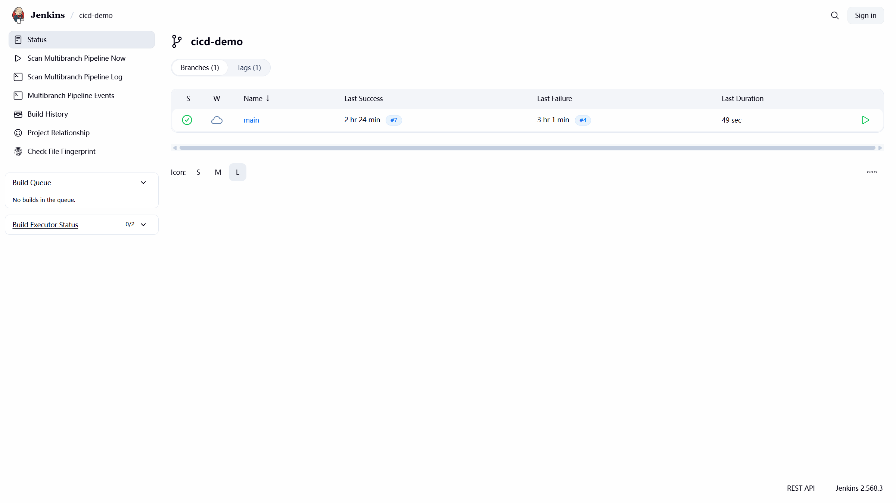
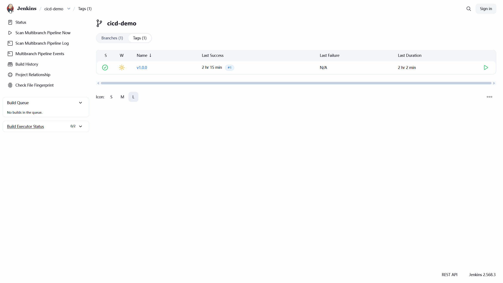
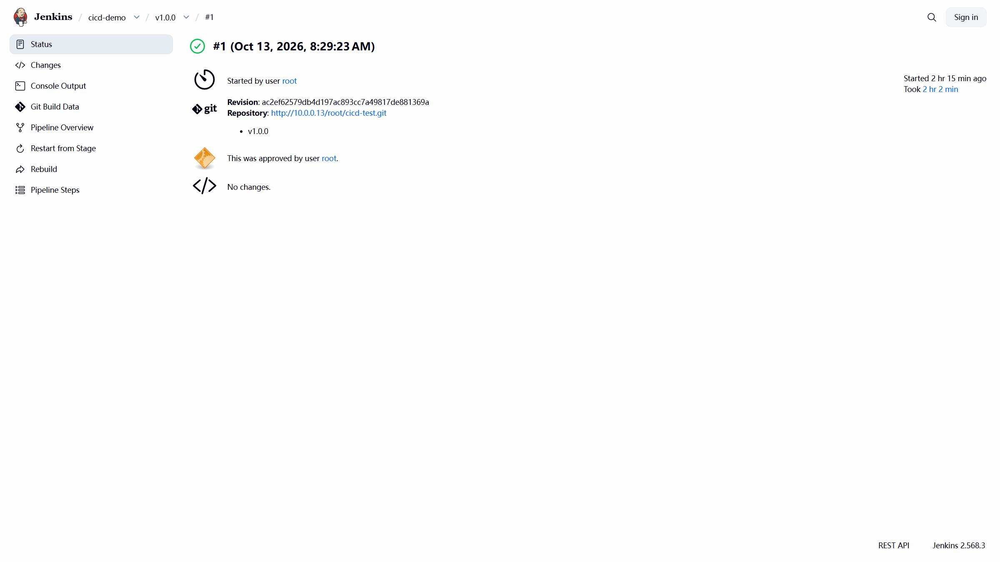
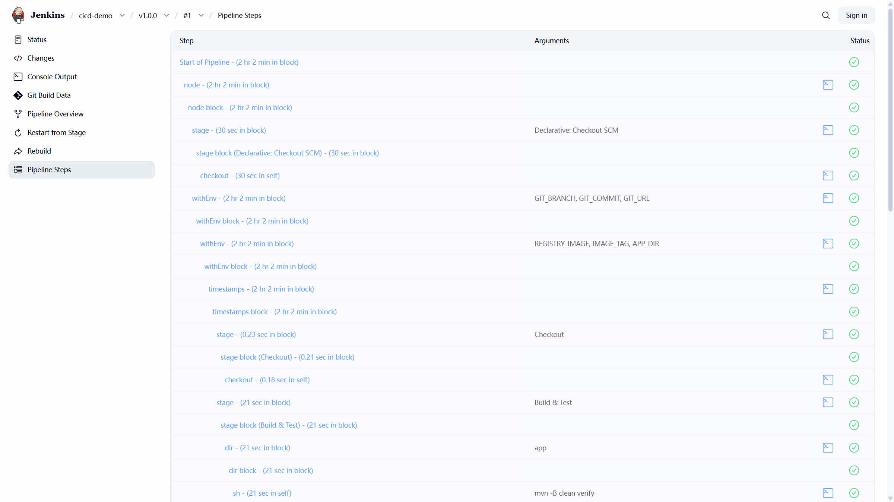
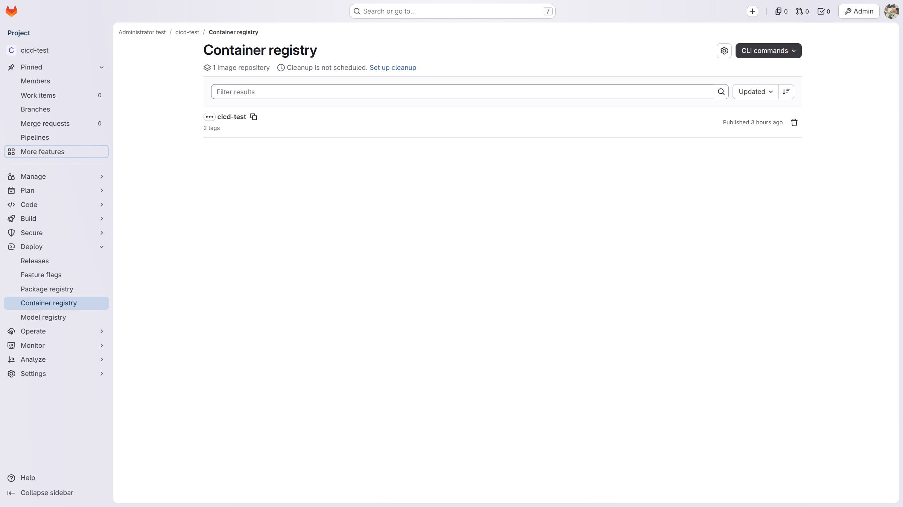

# 阶段1部署操作手册（GitLab仓 + Jenkins）

> **目标**：同一镜像 → app-dev **8090(dev)** + **8091(test)**；打 `v*` tag → 人工 `input` → app-prod **8092(prod)**。  
> **前提**：阶段 0 已通（GitLab 仓 + Jenkins + Webhook）。见 [阶段0部署操作手册-GitLab仓与Jenkins.md](./阶段0部署操作手册-GitLab仓与Jenkins.md)。  
> **配套**：[jenkins-gitlab-small-company.md](./jenkins-gitlab-small-company.md) · [implement-jenkins.md](./implement-jenkins.md)  
> **账号密码全文**：[环境凭据一览.md](./环境凭据一览.md)  
> **文档约定**：实施过程中在本文件勾选进度、补踩坑、补截图（`docs/images/phase1/`）。

---

## 0. 环境与状态

| 角色 | IP | 阶段1用途 |
|------|-----|-----------|
| platform | 10.0.0.13 | GitLab + Jenkins + **Docker 构建镜像** + Registry |
| app-dev | 10.0.0.12 | Compose：**dev 8090** + **test 8091**（停用或并存阶段0 systemd） |
| app-prod | 10.0.0.11 | Compose：**prod 8092**（本阶段首次启用） |

| 服务 | 地址 |
|------|------|
| GitLab | http://10.0.0.13 |
| Jenkins | http://10.0.0.13:8081 |
| Registry | `10.0.0.13:5050/root/cicd-test`（已启用） |
| 应用 | `http://10.0.0.12:8090` · `:8091` · `http://10.0.0.11:8092` |

### 0.2 登录账号（摘要）

| 系统 | 地址 | 用户名 | 密码 |
|------|------|--------|------|
| GitLab | http://10.0.0.13 | `root` | `7ChvoInxILTnI5skTMTR` |
| Jenkins | http://10.0.0.13:8081 | `root` | `yq4QnbJKVTUjwv4juBJZ` |
| Registry / `docker login` | `10.0.0.13:5050` | `root` | PAT `3421b99f1706de819496017f65bb38e2c64e484a` |
| Jenkins 凭据 `registry-credentials` | — | `root` | 同上 PAT |
| Jenkins 凭据 `gitlab-credentials` | — | `root` | 同上 PAT |
| SSH 部署 | `deploy@10.0.0.12` / `.11` | `deploy` | 私钥 `.secrets/cicd-deploy` |

完整说明见 [环境凭据一览.md](./环境凭据一览.md)。

### 0.1 进度板（实施时勾选）

| # | 步骤 | 状态 | 约时 |
|---|------|------|------|
| 1 | platform 装 Docker，`jenkins` 入 docker 组 | ✅ 完成 | 15～25 分 |
| 2 | 启用 GitLab Container Registry + Deploy Token | ✅ 完成 | 20～40 分 |
| 3 | Jenkins：`registry-credentials` + 全局变量 | ✅ 完成 | 10～15 分 |
| 4 | app-dev / app-prod：Docker + Compose 目录 + docker login | ✅ 完成 | 30～45 分 |
| 5 | 恢复完整 `Jenkinsfile`（Docker 部署） | ✅ 完成 | 15～25 分 |
| 6 | push `main` → 镜像 → 部署 8090 + 8091 | ✅ 完成 | 20～40 分 |
| 7 | tag `v*` → Approve → 部署 8092 | ✅ 完成（`v1.0.0` #1 SUCCESS） | 15～30 分 |
| 8 | 验收 + 回滚演练；补截图/踩坑 | ✅ 完成 | 20～30 分 |

图例：⬜ 待做 · 🟡 进行中 · ✅ 完成

**阶段1验收结论（2026-10-13）**：同一 commit `ac2ef62` → Registry 镜像 → **dev/test/prod** 三环境页面均通；`v1.0.0` 经 Approve 部署 prod。

---

## 1. 架构（阶段1）

```text
push main / tag v*
    → GitLab 仓 + Webhook
    → Jenkins
        → mvn verify
        → docker build & push → GitLab Registry
        → (main) SSH 到 app-dev：compose pull/up  → 8090 + 8091
        → (tag v*) input 审批 → SSH 到 app-prod：compose up → 8092
```

原则：**Build Once, Promote Many** —— 三环境共用同一 `IMAGE_TAG`。

---

## 2. 与阶段0的关系

| 项 | 阶段0 | 阶段1 |
|----|-------|-------|
| 制品 | jar + systemd | Docker 镜像 + Compose |
| app-dev | `/opt/cicd-demo` + 8090 | `/opt/cicd-demo-dev` + `/opt/cicd-demo-test` |
| app-prod | 不用 | `/opt/cicd-demo-prod` + 8092 |
| Jenkinsfile | 仅 scp jar | Build Image + compose deploy + `input` |

**建议**：阶段1首次验收前，可先 `sudo systemctl stop cicd-demo`，避免与 Compose 抢 **8090**。

---

## 3. platform：Docker（Jenkins 构建用）

```bash
sudo apt install -y docker.io
sudo usermod -aG docker jenkins
sudo systemctl restart jenkins
# 验证
sudo -u jenkins -H docker ps
```

若 `permission denied`：确认 jenkins 已在 docker 组且服务已重启。

---

## 4. GitLab Container Registry

### 4.1 启用与地址

1. GitLab 项目 `cicd-test` → **Deploy → Container Registry**（或 Admin 启用 Registry）
2. 记下镜像前缀，本环境计划：

```text
REGISTRY_IMAGE=10.0.0.13:5050/root/cicd-test
```

### 4.2 Deploy Token

项目 → **Settings → Repository → Deploy tokens**（或 Access Tokens）：

- 权限：`read_registry` + `write_registry`（拉代码另用已有 `gitlab-credentials`）
- 用户名 + token → Jenkins 凭据 **`registry-credentials`**

### 4.3 HTTP Registry（内网无 TLS）

在 **platform、app-dev、app-prod** 配置 Docker insecure-registries，例如 `/etc/docker/daemon.json`：

```json
{
  "insecure-registries": ["10.0.0.13:5050"]
}
```

然后：

```bash
sudo systemctl restart docker
```

（platform 上若 jenkins 用 docker，重启后确认 `jenkins` 仍能 `docker ps`。）

---

## 5. Jenkins 配置增量

### 5.1 凭据

| ID | 类型 | Username / Secret | 用途 |
|----|------|-------------------|------|
| `registry-credentials` | Username + Password | `root` + PAT（见 [凭据一览](./环境凭据一览.md)） | 推/拉镜像 |
| `gitlab-credentials` | Username + Password | `root` + 同上 PAT | 拉代码（阶段0已有） |
| `deploy-ssh` | SSH Username with private key | `deploy` + `.secrets/cicd-deploy` | SSH 部署 |

口令全文：[环境凭据一览.md](./环境凭据一览.md)。

### 5.2 全局环境变量（在 `APP_DEV_HOST` 之外增加）

| Name | Value |
|------|--------|
| `APP_DEV_HOST` | `10.0.0.12`（已有） |
| `APP_PROD_HOST` | `10.0.0.11` |
| `REGISTRY_IMAGE` | `10.0.0.13:5050/root/cicd-test` |

### 5.3 Webhook

确认 GitLab Webhook 已勾选 **Tag push events**（阶段0若只勾了 Push，请补上）。

URL 仍为：`http://10.0.0.13:8081/project/cicd-demo`

### 5.4 多分支流水线须「发现标签」

`cicd-demo` → **配置** → Branch Sources → Behaviours 增加 **Discover tags**（仅 Branch Discovery 时，Tags 页不会出现 `v*`）。

改完后点 **立即扫描多分支流水线**；已有 tag 可手动 Build。

---

## 6. 业务机：Docker + Compose

### 6.1 两台都装 Docker

在 **app-dev**、**app-prod**：

```bash
sudo apt install -y docker.io docker-compose-plugin
sudo usermod -aG docker deploy
# deploy 重新登录后再测
```

### 6.2 app-dev 目录

```bash
sudo mkdir -p /opt/cicd-demo-dev /opt/cicd-demo-test
sudo cp deploy/compose/dev/compose.yaml /opt/cicd-demo-dev/
sudo cp deploy/compose/dev/.env.example /opt/cicd-demo-dev/.env
sudo cp deploy/compose/test/compose.yaml /opt/cicd-demo-test/
sudo cp deploy/compose/test/.env.example /opt/cicd-demo-test/.env
# 编辑 .env：REGISTRY_IMAGE、SPRING_PROFILES_ACTIVE=dev|test
sudo chown -R deploy:deploy /opt/cicd-demo-dev /opt/cicd-demo-test
sudo chmod 600 /opt/cicd-demo-dev/.env /opt/cicd-demo-test/.env
```

端口：dev **8090**、test **8091**（见仓库 `deploy/compose/*/compose.yaml`）。

### 6.3 app-prod 目录

```bash
sudo mkdir -p /opt/cicd-demo-prod
sudo cp deploy/compose/prod/compose.yaml /opt/cicd-demo-prod/
sudo cp deploy/compose/prod/.env.example /opt/cicd-demo-prod/.env
# 编辑 .env：REGISTRY_IMAGE、SPRING_PROFILES_ACTIVE=prod
sudo chown -R deploy:deploy /opt/cicd-demo-prod
sudo chmod 600 /opt/cicd-demo-prod/.env
```

端口：**8092**。

### 6.4 docker login（deploy 用户）

```bash
docker login 10.0.0.13:5050
# 用户名 root，密码为 PAT（见 docs/环境凭据一览.md）
```

三台凡要 pull 的机器都做一次（至少 app-dev、app-prod；platform 推送用 Jenkins 凭据）。

### 6.5 deploy SSH

阶段0已把公钥写到 app-dev 的 `deploy`。阶段1需确保 **app-prod** 同样有公钥，且 `deploy-ssh` 能连 `10.0.0.11`。

---

## 7. Jenkinsfile（阶段1）

仓库根目录恢复 / 使用完整流水线，逻辑概要：

1. Checkout  
2. Build & Test（`mvn -B clean verify`）  
3. Build & Push Image（`main` 或 `v*` tag）  
4. Deploy Dev / Deploy Test（`main`，compose on app-dev）  
5. Approve Prod（`v*` + `input`）  
6. Deploy Prod（`v*`，compose on app-prod）  

实现时以仓库当前 `Jenkinsfile` 为准；改完后在本节注明 commit / 关键变更。

**审批注意**：`input` 会阻塞；若 Agent idle 超时，将 Approve 放在 `agent none` 的 stage。

---

## 8. 发布与验收

### 8.1 日常（dev + test）

```bash
git push gitlab main
```

期望：推镜像 → 更新 8090、8091。

### 8.2 生产

```bash
git tag v1.0.0
git push gitlab v1.0.0
```

Jenkins → 停在 Approve → 人工点 Deploy → 8092。

### 8.3 验收清单

- [x] 一次构建一个 `IMAGE_TAG`，三环境可共用（验收时 `ac2ef62`）  
- [x] `http://10.0.0.12:8090/` 为 **dev**  
- [x] `http://10.0.0.12:8091/` 为 **test**  
- [x] `http://10.0.0.11:8092/` 为 **prod**（经审批；`v1.0.0` #1）  
- [x] 改业务机 `.env` 密钥无需重建镜像（Compose `env_file`）  
- [x] 回滚：改 `IMAGE_TAG` 后 `docker-compose pull && up -d`（本环境为 v1 命令）  

### 8.4 回滚命令（目标机）

```bash
cd /opt/cicd-demo-prod   # 或 -dev / -test
# 编辑 .env 中 IMAGE_TAG=上一成功值
docker-compose down --remove-orphans || true
docker-compose pull && docker-compose up -d
```

---

## 9. 踩坑记录（实施时追加）

| # | 现象 | 原因 | 处理 | 日期 |
|---|------|------|------|------|
| 1 | `Unable to locate package docker-compose-plugin` | Ubuntu 源无 compose plugin | 改装 `docker.io` + `docker-compose`（v1） | 2026-10-13 |
| 2 | `docker compose` 命令不存在 | 仅有 v1 二进制 | Jenkinsfile 使用 `docker-compose` | 2026-10-13 |
| 3 | `docker build` 拉 `eclipse-temurin` 失败：`connection refused` 到 docker.io | platform 无法直连 Docker Hub | `/etc/docker/daemon.json` 加 `registry-mirrors`（如 daocloud）后重启 docker | 2026-10-13 |
| 4 | `docker-compose up`：`KeyError: 'ContainerConfig'` | compose v1.29 + Docker 29 recreate 不兼容 | 部署前 `docker-compose down` + `docker rm` 再 `up -d`（已写进 Jenkinsfile） | 2026-10-13 |
| 5 | Compose 映射 `8090:8080` 但页面连不上 | `application-dev.yml` 把容器内端口改成 8090 | 去掉 profile 内 `server.port`；`.env` 加 `SERVER_PORT=8080`；systemd 用 `SERVER_PORT=8090` | 2026-10-13 |
| 6 | push `v1.0.0` 后 Jenkins 只有 `main`、无 Tags | 多分支未开 Discover tags | Branch Sources 增加 Tag Discovery 后扫描；手动 Build `v1.0.0` | 2026-10-13 |

已知风险（实施前注意）：

1. **8090 端口冲突**：阶段0 systemd 与 Compose 同时占 8090 → 已 `systemctl stop`（sudoers 若无 stop，需 root 停一次）。  
2. **docker permission denied**：`jenkins`/`deploy` 未进 docker 组或未重新登录。  
3. **HTTP Registry 拉失败**：未配 `insecure-registries`。  
4. **Webhook 不触发 tag**：未勾选 Tag push events。  
5. **input 后 Agent 消失**：审批 stage 分离或增大 idle。  
6. **与 GitLab CI 双开**：勿同时自动部署同一 prod。  
7. **无 Discover tags**：打 tag 后 Jenkins 不出现 `v*` 任务（见 §5.4 / 踩坑#6）。

---

## 10. 截图目录

```text
docs/images/phase1/
  01-app-dev-8090.png                 # 8090 = dev
  02-app-test-8091.png                # 8091 = test
  03-app-prod-8092.png                # 8092 = prod（v1.0.0）
  04-jenkins-cicd-demo-main.png       # Multibranch main 绿
  05-jenkins-tag-v1.0.0.png           # Tags 页 v1.0.0 绿
  06-jenkins-v1.0.0-build1-success.png # #1 SUCCESS + approved by root
  07-jenkins-pipeline-steps-approve.png # Pipeline Steps（含 Approve Prod）
  08-gitlab-container-registry.png    # GitLab Container Registry（2 tags）
```

| 图 | 说明 |
|----|------|
|  | dev |
|  | test |
|  | prod |
|  | Jenkins main |
|  | Jenkins tag |
|  | Approve 后 SUCCESS |
|  | Pipeline Steps |
|  | Registry |

---

## 11. 变更日志

| 日期 | 内容 |
|------|------|
| 2026-10-13 | 初稿：按实机 IP 写阶段1操作清单，待实施勾选与补图 |
| 2026-10-13 | 步骤1：platform 已装 docker.io；jenkins 在 docker 组；`docker ps` 正常。systemd 暂不停 |
| 2026-10-13 | 步骤2：启用 `registry_external_url http://10.0.0.13:5050`；platform 配 insecure-registries；PAT `jenkins-registry-phase1` 登录成功 |
| 2026-10-13 | 步骤3：Jenkins 已加 `registry-credentials`；全局变量 APP_PROD_HOST、REGISTRY_IMAGE |
| 2026-10-13 | 步骤4：app-dev/app-prod 装 Docker+compose v1；Compose 目录与 docker login 完成；prod SSH deploy 密钥已配；app-prod 磁盘扩至 ~38G |
| 2026-10-13 | 步骤5：仓库 `Jenkinsfile` 已改为阶段1（docker-compose）；**需本机 push 后生效** |
| 2026-10-13 | 步骤6：镜像已推 Registry；手工 Compose 已起 **8090=dev / 8091=test**；systemd 已停；待 push：compose recreate 规避 + 去掉 dev 内嵌 8090 端口 |
| 2026-10-13 | 步骤6收尾：`main` #5+ 绿；8090/8091 稳定 |
| 2026-10-13 | 步骤7：开启 Discover tags；`v1.0.0` #1 Approve → Deploy Prod → **8092=prod** SUCCESS |
| 2026-10-13 | 步骤8：验收清单勾选；补 `docs/images/phase1/` 共 8 张；手册收尾 |
| 2026-10-15 | 增补登录账号密码摘要；全文见 [环境凭据一览.md](./环境凭据一览.md) |
